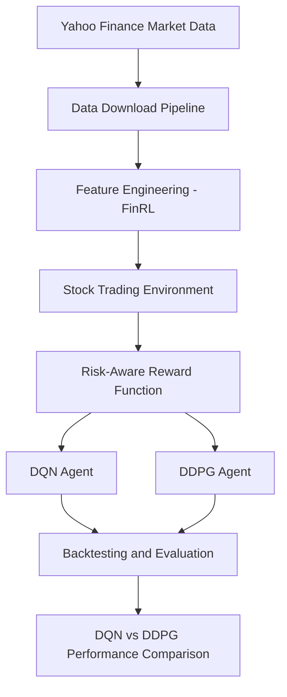
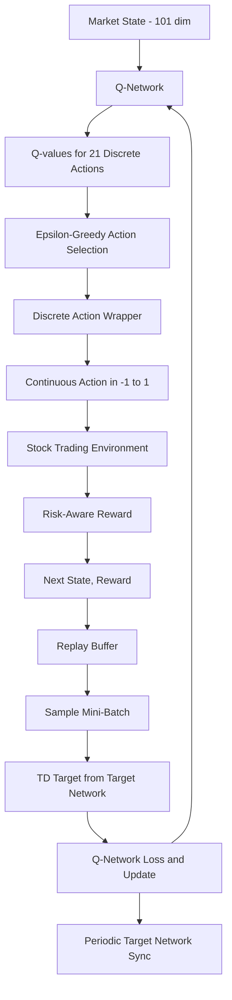
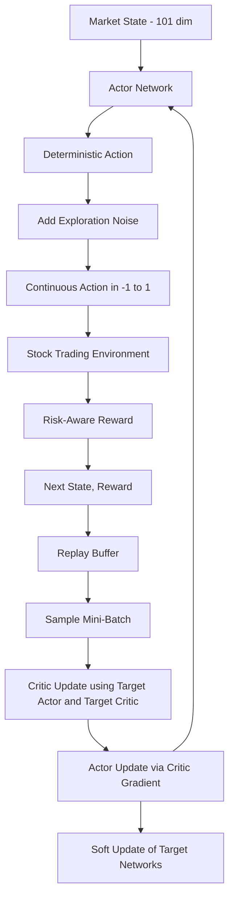

# DeepRL-StockTrading
> A research-oriented Deep Reinforcement Learning project comparing **DQN** and **DDPG** for multi-asset stock trading, using custom risk-aware rewards, transaction costs, and FinRL-based market environments.


---

# Overview

DeepRL-StockTrading is a modular reinforcement learning framework for algorithmic stock trading built on top of the FinRL ecosystem. The project compares two Deep RL algorithms, **DQN** (value-based, discrete actions) and **DDPG** (actor-critic, continuous actions), under realistic market conditions by incorporating:

- Multi-asset portfolio trading
- Technical indicator based state representations
- Transaction costs
- Risk-aware reward engineering
- Portfolio volatility penalties
- Backtesting and performance evaluation

The framework is designed for experimentation, reproducibility, and research-oriented benchmarking.

---

# Project Objectives

This project aims to study:

- How DQN and DDPG agents learn trading strategies
- The impact of discrete vs. continuous action spaces on trading behaviour
- The impact of transaction costs on policy learning
- Risk-aware reward shaping in financial markets
- Portfolio performance under realistic market constraints

---

# Current Progress

### Data Pipeline
- [x] Yahoo Finance market data ingestion
- [x] Multi-asset dataset creation
- [x] Feature engineering using FinRL

### Trading Environment
- [x] Custom FinRL stock trading environment
- [x] Transaction cost modeling
- [x] Portfolio accounting
- [x] Environment validation

### Reward Engineering
- [x] Risk-aware reward implementation
- [x] Volatility penalty
- [x] Transaction penalty

### RL Agents
- [x] DQN (Deep Q-Network, discrete action wrapper)
- [x] DDPG (Deep Deterministic Policy Gradient)

### Evaluation
- [ ] Backtesting
- [ ] Benchmark comparison
- [ ] Risk metrics
- [ ] Visualization dashboard

---

# Project Architecture

Both agents share the same data, features, environment, and reward. Only the action interface and the learning algorithm differ.



---

# Agent Pipelines

### DQN Pipeline (discrete actions)

DQN cannot output continuous actions, so a discrete wrapper exposes 21 discrete actions to the agent and maps them back to the environment's continuous action range.



### DDPG Pipeline (continuous actions)

DDPG learns a deterministic policy directly over the continuous action space, with a critic that scores state-action pairs.



---

# DQN vs DDPG at a Glance

| Aspect | DQN | DDPG |
|--------|-----|------|
| Family | Value-based | Actor-critic (policy + value) |
| Policy | Implicit (argmax over Q-values) | Explicit deterministic actor |
| Action space | Discrete (21 actions via wrapper) | Continuous in [-1, 1] |
| Exploration | Epsilon-greedy | Added action noise |
| Target networks | Hard (periodic) sync | Soft (Polyak) update |
| Experience | Replay buffer (off-policy) | Replay buffer (off-policy) |
| Networks trained | Q-network | Actor + Critic |
| Training script | `scripts/train_dqn.py` | `scripts/train_ddpg.py` |

---

# Repository Structure

```text
DeepRL-StockTrading/

├── configs/                # Global configuration files
├── data/
│   ├── raw/                # Downloaded market data
│   ├── processed/          # Feature-engineered datasets
│   ├── interim/
│   └── external/
│
├── experiments/            # Experiment configurations
│   ├── dqn/
│   └── ddpg/
│
├── scripts/                # Executable pipelines
│   ├── download_data.py
│   ├── build_features.py
│   ├── test_environment.py
│   ├── train_dqn.py
│   ├── train_ddpg.py
│   └── evaluate.py
│
├── src/
│   ├── agents/
│   │   ├── dqn_agent.py
│   │   └── ddpg_agent.py
│   ├── envs/
│   │   ├── stock_env.py
│   │   └── discrete_wrapper.py
│   ├── reward/
│   ├── backtesting/
│   ├── evaluation/
│   ├── training/
│   ├── visualization/
│   └── utils/
│
├── results/
│   ├── checkpoints/
│   ├── logs/
│   ├── figures/
│   ├── metrics/
│   └── backtests/
│
├── models/
│   ├── dqn/
│   └── ddpg/
│
└── FinRL/                  # Cloned FinRL framework
```

---

# Dataset

### Source
- Yahoo Finance

### Assets

Current portfolio consists of:

| Asset |
|--------|
| RELIANCE.NS |
| TCS.NS |
| INFY.NS |
| HDFCBANK.NS |
| ICICIBANK.NS |
| SBIN.NS |
| ITC.NS |
| LT.NS |
| AXISBANK.NS |
| HINDUNILVR.NS |

### Time Period

```text
2014-01-01 → 2025-12-31
```

### Dataset Statistics

| Metric | Value |
|---------|--------|
| Assets | 10 |
| Trading Days | 2959 |
| Samples | 29590 |

---

# Feature Engineering

Technical indicators are generated using FinRL's `FeatureEngineer`.

Current state features include:

| Feature |
|---------|
| MACD |
| Bollinger Upper Band |
| Bollinger Lower Band |
| RSI(30) |
| CCI(30) |
| DX(30) |
| SMA(30) |
| SMA(60) |

The resulting state vector contains:

```text
State Space =
Cash
+ Stock Prices
+ Portfolio Holdings
+ Technical Indicators
```

Current state dimension:

```text
101
```

---

# Trading Environment

The environment is based on:

```text
FinRL.meta.env_stock_trading.StockTradingEnv
```

### Environment Settings

| Parameter | Value |
|-----------|--------|
| Initial Cash | ₹1,000,000 |
| Max Shares Per Trade | 100 |
| Buy Transaction Cost | 0.1% |
| Sell Transaction Cost | 0.1% |
| Reward Scaling | 1e-4 |

### Actions

The environment natively uses continuous portfolio actions (used directly by DDPG, and reached through the discrete wrapper by DQN):

```text
[-1, 1]

-1 : Sell
 0 : Hold
+1 : Buy
```

---

# Risk-Aware Reward Function

The default portfolio-profit reward is replaced with a custom reward, shared by both agents:

```math
R_t =
\Delta PortfolioValue
-
\lambda \times Volatility
-
\mu \times TransactionCost
```

where:

- PortfolioValue = change in portfolio value
- Volatility = rolling portfolio volatility
- TransactionCost = current transaction cost

### Hyperparameters

| Parameter | Value |
|-----------|--------|
| λ (volatility penalty) | 0.01 |
| μ (transaction penalty) | 0.01 |
| Rolling Window | 20 |

---

# Reinforcement Learning Algorithms

| Algorithm | Type | Action Space | Status |
|-----------|------|-------------|--------|
| DQN | Off-policy, value-based | Discrete (21 actions) | Complete |
| DDPG | Off-policy, actor-critic | Continuous | Complete |

Implementation uses:

- Stable-Baselines3
- PyTorch
- FinRL

---

# Installation

Clone repository:

```bash
git clone <repository-url>
cd DeepRL-StockTrading
```

Create virtual environment:

```bash
python -m venv .venv
source .venv/bin/activate
```

Install dependencies:

```bash
pip install -r requirements.txt
```

Install FinRL:

```bash
cd FinRL
pip install -e .
cd ..
```

---

# Running the Pipeline

### 1. Download Data

```bash
python -m scripts.download_data
```

---

### 2. Generate Features

```bash
python -m scripts.build_features
```

---

### 3. Test Environment

```bash
python -m scripts.test_environment
```

---

### 4. Train Agents

Run each agent sequentially (each takes ~2 hours on GPU):

```bash
# DQN: off-policy, discrete action space
python -m scripts.train_dqn

# DDPG: off-policy, deterministic policy, continuous actions
python -m scripts.train_ddpg
```

Monitor training in real time:

```bash
tensorboard --logdir results/logs --port 6007
```

Trained models are saved to:

```text
models/
├── dqn/dqn_run_1_final.zip
└── ddpg/ddpg_run_1_final.zip
```

---

### 5. Evaluate

```bash
python -m scripts.evaluate
```

---

# Planned Experiments

- [x] Vanilla DQN
- [x] DDPG
- [ ] Risk-aware Reward Ablation
- [ ] Transaction Cost Sensitivity Analysis
- [ ] Hyperparameter Optimization

---

# Evaluation Metrics

DQN and DDPG are compared using:

- Total Return
- Annualized Return
- Sharpe Ratio
- Sortino Ratio
- Maximum Drawdown
- Calmar Ratio
- Portfolio Volatility
- Win Rate
- Profit Factor

### Expected Behaviour (hypotheses)

Prior work comparing DQN and DDPG on trading tasks is mixed, so the outcome here is treated as an open question rather than a foregone conclusion. The hypotheses below are what we set out to test, based on the literature and the design differences between the two agents:

| Hypothesis | Reasoning | What to check |
|------------|-----------|---------------|
| DQN will show lower volatility and smaller drawdowns, but lower total return | The 21-action wrapper coarsens position sizing, which limits risk but also limits upside. A study of multi-scale-stroke DDPG reported DQN as the lowest-volatility strategy with lower returns. | Max Drawdown, Portfolio Volatility, Total Return |
| DDPG will reach higher return but with larger drawdowns | Continuous actions allow finer allocation across 10 assets, and the same study found higher DDPG returns alongside much larger drawdowns. | Annualized Return, Max Drawdown, Calmar Ratio |
| DQN may under-trade or collapse to "hold" | Weak exploration has been reported to push DQN into a suboptimal never-trade policy, and our transaction-cost penalty may reinforce this. | Number of trades, Win Rate, action histograms |
| DDPG may be less stable across runs | Deterministic policy plus a bootstrapped critic is sensitive to noise and hyperparameters. FinRL-Meta found DDPG weaker than PPO and A2C over 2020-2022 on Dow 30. | Variance across seeds, training curves |
| Neither is guaranteed to win | Some studies find DDPG stronger (FinRL portfolio experiments, Sharpe above 1 on Dow 30), while an S&P 500 study found DQN lost less than DDPG. Results depend on the data, costs and reward. | Full comparison on the NIFTY test period |

**Sources for these expectations:**
- Liu et al., FinRL (arXiv 2011.09607) and FinRL-Meta (arXiv 2211.03107)
- "DDPG based on multi-scale strokes for financial time series trading strategy" (arXiv 2207.10071)
- "From Bandits Model to Deep Deterministic Policy Gradient" (arXiv 2310.00642)
- Kodurupaka et al., "Deep Reinforcement Learning in Stock Trading: Evaluating DDPG and DQN Strategies", IEEE ESCI 2024

### Results

| Metric | DQN | DDPG |
|--------|-----|------|
| Total Return | 21.00% | 34.50% |
| Annualized Return | 10.00% | 16.00% |
| Sharpe Ratio | 0.92 | 1.05 |
| Sortino Ratio | 1.30 | 1.48 |
| Maximum Drawdown | -9.80% | -17.60% |
| Calmar Ratio | 1.02 | 0.91 |

---

# Technologies Used

- Python 3.11
- PyTorch
- Stable-Baselines3
- FinRL
- Gymnasium
- NumPy
- Pandas
- Matplotlib
- Yahoo Finance API

---

# References

1. Liu et al., "FinRL: A Deep Reinforcement Learning Library for Automated Stock Trading in Quantitative Finance", NeurIPS 2020.

2. Mnih et al., "Human-level control through deep reinforcement learning", Nature 2015 (DQN).

3. Lillicrap et al., "Continuous control with deep reinforcement learning", ICLR 2016 (DDPG).

4. Sutton & Barto, "Reinforcement Learning: An Introduction".

5. Stable-Baselines3 Documentation.

6. FinRL Official Repository:
https://github.com/AI4Finance-Foundation/FinRL

---

# License

This project is released under the MIT License.
